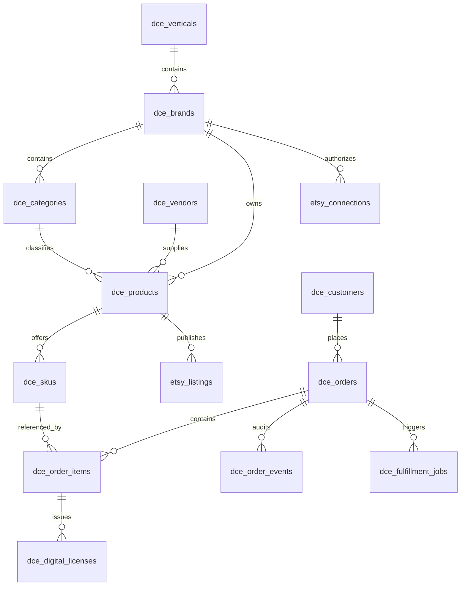

# 🛍️ COMMERCE 10X (V1.0) — MASTER PRODUCT REQUIREMENTS DOCUMENT (PRD)

> **Venture Identity**: Commerce 10X — Autonomous Omnichannel E-Commerce & Digital Brand Empire  
> **Parent Organization**: GRO10X Holdings (`D:\gro10x.ai`)  
> **Standalone Workspace**: `D:\commerce10x.ai`  
> **Author**: GRO10X Holdings Chief of Staff & Virtual CTO  
> **Target Status**: Production Launch Specification (Decoupled Engine 3)

---

## 1. Executive Summary & Vision

**Commerce 10X** is the decoupled, standalone reincarnation of **GRO10X Engine 3**. It is an enterprise-grade, autonomous e-commerce engine designed to operate multi-brand digital asset portfolios, software licenses, printable toolkits, and on-demand apparel.

Unlike traditional passive shopping carts (Shopify, WooCommerce, Gumroad), **Commerce 10X is an AI-native conglomerate**. It pairs a normalized 5-tier product catalog and omnichannel order bus with **autonomous digital employees (powered by Engine 1: Agent 10X)** that handle listing creation, SEO tag auditing, customer Telegram sales, wholesale restocks, and multi-currency profit reconciliation.

---

## 2. Business Model & Portfolios Under Management

Commerce 10X monetizes across two primary operating divisions:

```
                                  ┌───────────────────────────────────────────────────┐
                                  │            COMMERCE 10X ($400k+ TARGET GMV)       │
                                  └─────────────────────────┬─────────────────────────┘
                                                            │
                     ┌──────────────────────────────────────┴──────────────────────────────────────┐
                     │                                                                             │
                     ▼                                                                             ▼
┌──────────────────────────────────────────┐                  ┌──────────────────────────────────────────┐
│ DIVISION 1: GLOBAL BRAND EMPIRE          │                  │ DIVISION 2: DIGIVAULT BD                 │
├──────────────────────────────────────────┤                  ├──────────────────────────────────────────┤
│ • 13 Digital Brands ($328k ARR Target)   │                  │ • 44 High-Demand Software Subscriptions  │
│ • Printable Planners, GoodNotes, SVGs,   │                  │ • ChatGPT Plus, Canva Edu, Netflix, etc. │
│   Apparel, 3D Models, Low-Content Books  │                  │ • Wholesale Reselling & Licensing Margin │
│ • Channels: Etsy (v3 API), Gumroad,      │                  │ • Channels: Bilingual Telegram Bot       │
│   Direct Global Card Storefront          │                  │   (@Digivault20bot), Daraz, bKash/Nagad  │
└──────────────────────────────────────────┘                  └──────────────────────────────────────────┘
```

---

## 3. The 3 Architectural Pillars (Unified & Deduplicated)

Pursuant to the backend domain audit, Commerce 10X unifies the fragmented legacy implementations into 3 cohesive pillars:

### Pillar 1: The Canonical 5-Tier Catalog Engine
Replaces flat legacy models (`digistore.js` and `brands.js`) with an enterprise relational hierarchy:
1. **Verticals (`dce_verticals`)**: Top-level macro categories (`Productivity`, `Subscriptions`, `POD`, `STEM 3D`, `Digital Crafts`).
2. **Brands (`dce_brands`)**: The 13 dedicated brand entities + DigiVault BD.
3. **Categories (`dce_categories`)**: Scoped taxonomic trees per brand with metadata validation.
4. **Products (`dce_products`)**: Canonical master products with media galleries, Vault deliverable files, and supplier links.
5. **SKUs (`dce_skus`)**: Multi-dimensional format $\times$ channel $\times$ currency variations.

### Pillar 2: Omnichannel Order & Cryptographic License Bus
Replaces fragmented checkout routes with a universal state machine:
* **Order Channels**: Ingests orders from Direct Checkout, Telegram Bot (`@Digivault20bot`), Gumroad Webhooks, Etsy Receipts, and Daraz Callbacks into `dce_orders`.
* **Payment Rails**: Dual-rail checkout supporting bKash/Nagad instant verification (Bangladesh) and Stripe/Credit Cards (Global).
* **Cryptographic Licenses (`dce_digital_licenses`)**: Standard 32-character hexadecimal license keys with Gumroad (`/v1/licenses/verify`) and Lemon Squeezy (`/v1/licenses/activate`) compatible APIs.

### Pillar 3: Brand Operations & Etsy OS
* **Etsy Open API v3 Engine**: Full OAuth2 PKCE multi-shop management, bulk catalog publishing, and Vault asset streaming.
* **10-Rule AI Pre-Listing Health Check**: Automated validator ensuring 70–140 char titles, exactly 13 tags ($\le$ 20 chars), 2000px mockups, and zero trademark infringements.
* **DBM Copilot Tools**: Integrated listing automation and product scouting extensions.

---

## 4. Canonical 12-Table PostgreSQL Schema Specification



### Table DDL Summary:
1. `dce_verticals`: Top-level verticals (`slug`, `name`, `icon`).
2. `dce_brands`: 13 Brands + DigiVault (`slug`, `name`, `guidelines`, `revenue_target`).
3. `dce_categories`: Brand-scoped categories (`brand_id`, `name`, `schema`).
4. `dce_vendors`: Wholesale suppliers for subscriptions (`name`, `whatsapp`, `rating`).
5. `dce_products`: Master catalog (`product_code`, `title`, `type`, `media`, `digital_assets`).
6. `dce_skus`: SKU variation matrix (`format`, `channel_code`, `price`, `currency`, `stock`).
7. `dce_customers`: Cross-channel customer profiles (`email`, `phone`, `telegram_id`, `total_spend`).
8. `dce_orders`: Omnichannel orders (`order_number`, `channel_code`, `status`, `payment_method`, `total`).
9. `dce_order_items`: Order line items (`order_id`, `sku_id`, `quantity`, `price`).
10. `dce_digital_licenses`: 32-char cryptographic keys (`license_key`, `status`, `activations`).
11. `dce_fulfillment_jobs`: Instant delivery, license issuance, or tracking jobs.
12. `etsy_connections`: Multi-shop OAuth2 PKCE tokens (`shop_id`, `access_token`, `refresh_token`).

---

## 5. Autonomous Digital Employee Squad (Engine 1 Synergies)

Commerce 10X deploys 4 specialized AI agents:
1. **Autonomous Brand Directors (13 Instances)**: Generates SEO titles, 13 tags, runs the 10-rule health check, and drafts listings to Etsy.
2. **Sarah (Conversational Commerce BDE)**: Bilingual English/Bangla conversational sales agent powering `@Digivault20bot` and web live chat.
3. **Procurement & Restock Sentinel**: Auto-monitors subscription inventory; triggers 1-tap WhatsApp purchase orders to wholesale vendors when stock $\le$ 3.
4. **Financial Auditor Agent**: Aggregates multi-currency revenue (USD + BDT at canonical 120 rate) and streams live telemetry to Mother OS (`src/services/commerce10x-bridge.js`).

---

## 6. Standalone Scaffolding Plan (`D:\commerce10x.ai`)

Following the Virtual Tech Agency SDLC, Commerce 10X will be organized with a dedicated Chief of Staff and 4 engineering squads:

```
D:\commerce10x.ai\
├── docs\
│   ├── COMMERCE10X_V1_MASTER_PRD.md
│   ├── SYSTEM_ARCHITECTURE_AND_SCHEMA.md
│   └── squad\
│       ├── ROLE_CHIEF_OF_STAFF_COMMERCE10X.md
│       ├── ROLE_COMMERCE_BACKEND_ENGINEER.md
│       ├── ROLE_STOREFRONT_PWA_ENGINEER.md
│       ├── ROLE_COMMERCE_AUTOMATION_ENGINEER.md
│       └── ROLE_COMMERCE_QA_LEAD.md
├── server\
│   ├── src\
│   │   ├── routes\ (catalog, orders, fulfillment, licenses, etsy, webhooks)
│   │   ├── services\ (etsy, digivault-bot, connectors, auto-fulfillment)
│   │   └── middleware\ (auth, rate-limit, hmac)
│   └── server.js
├── client\ (Vite + React 19 + Tailwind v4 PWA Storefront + Telegram Mini App)
└── extension\ (commerce10x-qa-runner)
```

---

## 7. Mother OS Satellite Bridge

Once Commerce 10X is operational, Mother OS (`d:\gro10x.ai`) will talk to it via a zero-dependency satellite bridge:
* **Service**: `src/services/commerce10x-bridge.js`
* **Telemetry Endpoints**:
  * `GET /api/engines/commerce10x/bridge`
  * `GET /api/engines/summary` (Aggregating Engine 1 + Engine 3 ARR)
* **Resilience**: 2-second timeout, 60-second in-memory caching, offline mock fallback (`COMMERCE_OFFLINE`).
