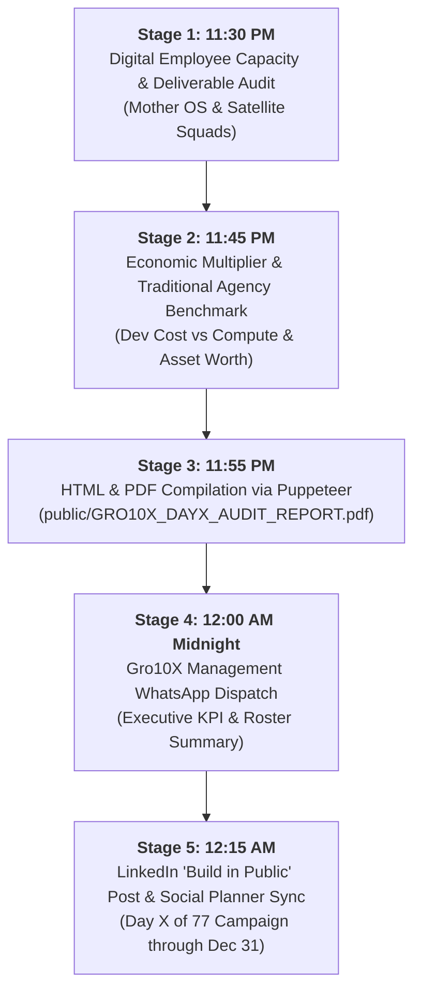

# 🏛️ GRO10X HOLDINGS: REPEATABLE MIDNIGHT DAY-CLOSE SOP
**Protocol Code:** `SOP-OPS-MIDNIGHT-DAYCLOSE-v1.0`  
**Standard Execution Window:** Every night from **11:30 PM to 12:15 AM (+06:00 BST)**  
**Mandatory Command Hierarchy:** Founder & CEO (`Firoz Uddin Ahmed`) × Central Chief of Staff (`Zayan`)

---

## 1. Objective & Principle
To eliminate ad-hoc, inconsistent daily closings, the GRO10X Conglomerate executes an immutable, automated **Midnight Day-Close Ritual** every 24 hours. No day ends without:
1. Reconciling digital employee capacity and man-hours.
2. Benchmarking economic asset value against traditional agency costs.
3. Compiling an executive vector PDF matching the canonical white/slate multi-page template.
4. Posting the condensed operational dispatch to the internal Gro10X Management WhatsApp group.
5. Publishing the daily "Build in Public" post to LinkedIn and archiving metrics in the Social Planner.

---

## 2. The 5-Stage Sequential Day-Close Protocol

### Stage 1: 11:30 PM — Digital Employee Capacity & Deliverable Audit
- **Census Check**: Tabulate all chartered digital employees active today across Central Core, Specialized Functional Engines (`[E1]`, `[E2]`, `[E3]`), and Satellite Squads (`[S1]`–`[S4]`).
- **Deliverables Ledger**: Map exact commits, prototypes, proposals, and customer receipts delivered by each employee.
- **Equivalent Output Hours**: Calculate equivalent human man-hours delivered by the digital squad.

### Stage 2: 11:45 PM — Economic Multiplier & Traditional Agency Benchmark
- Calculate total daily compute and token expenditure (e.g. ~$18.40).
- Tabulate traditional human dev shop costs for the same deliverables (e.g. 4–6 months, ৳37L–৳57L).
- Record Enterprise Asset Worth unlocked (e.g. ৳45L+) and compute ROI multiplier (e.g. ~2,100x).

### Stage 3: 11:55 PM — Multi-Page PDF & HTML Compilation
- Render the standardized 3-page or 4-page white/slate layout matching `public/GRO10X_DAY2_AUDIT_REPORT.html`.
- Run automated Puppeteer headless Chrome compilation to generate vector `public/GRO10X_DAYX_AUDIT_REPORT.pdf`.
- Force-add to git and push to `origin/main` for live Vercel production hosting (`https://gro10x-ai.vercel.app/GRO10X_DAYX_AUDIT_REPORT.pdf`).

### Stage 4: 12:00 AM Midnight — Internal Management WhatsApp Dispatch
- Deliver the formatted, mobile-friendly summary directly to Plabon.
- Plabon pastes the update into the internal **Gro10x Management Group** (Plabon, Rafsan, Core Team).

### Stage 5: 12:15 AM — "Build in Public" LinkedIn Post & Social Planner Logging
- Author the day's installment of the **"Build in Public (Day X of 77)"** campaign running through **December 31, 2026**.
- Ingest demographic and reach performance from the prior day's post (impressions, job titles, locations) to refine the hook.
- Log the post into Mother OS Social Planner (`social_posts` table) under the direction of the **Head of PR & Social Media Architect (`[E4]`)**.
