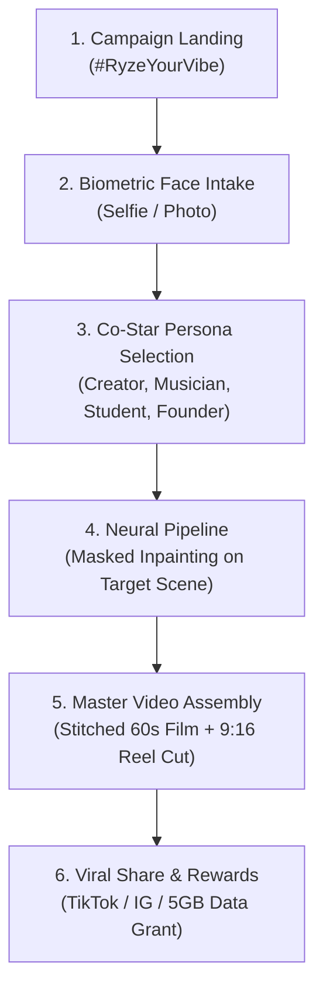

# 🏛️ PRODUCT REQUIREMENTS DOCUMENT (PRD): BANGLALINK RYZE "CO-STAR AI" PLATFORM

**Document Code:** `PRD-2026-RYZE-COSTAR-v1.0`  
**Venture / Context:** Engine 2: Bespoke Agency Services × Mother OS Foundry Lab  
**Authority:** Founder & CEO (`Firoz Uddin Ahmed`) × Central Chief of Staff & Virtual CTO (`Zayan`)  
**Companion Prototype:** [`public/prototypes/ryze-ai-star/index.html`](file:///D:/gro10x.ai/public/prototypes/ryze-ai-star/index.html)  
**Related Storyboard:** `RYZE AI HUB Functional Film (60 Seconds, 15 Beats, 100 Words)`  
**Status:** **ARCHITECTURAL ASSET BANKED IN HOLDINGS QUEUE (READY FOR SPRINT CHARTER)**  

---

## 1. Executive Product Vision & Core Campaign Law

### A. The Product Hook: "Co-Star in the RYZE Film"
Banglalink RYZE is launching the nationwide **#RyzeYourVibe** campaign powered by the 60-second functional brand film. Rather than a generic spectator ad, RYZE invites every young person in Bangladesh to **co-star directly inside the official commercial** alongside the lead brand ambassador.

### B. The Immutable Core Law (The Hero Invariant)
> [!IMPORTANT]
> **THE MAIN PROTAGONIST IS IMMUTABLE & FIXED.**
> The lead protagonist (the high-energy host/vlogger guiding the audience through the RYZE ecosystem) is the official brand ambassador. **His face, voice, and presence CANNOT be swapped.**
> 
> **Every participant swaps their own identity into ONE of the 4 Supporting Co-Star Archetypes**, creating a personalized commercial where the official RYZE hero visits, fist-bumps, and collaborates directly with **THEM**.

---

## 2. The 4 Co-Star Persona Tracks (Contest Pathways)

When an aspiring user enters the campaign, they choose their identity track:

```
┌──────────────────────────────────────────────────────────────────────────────────────────────────┐
│                             THE 4 RYZE CO-STAR SELECTION TRACKS                                  │
├─────────┬──────────────────────┬─────────────┬───────────────────────────────────────────────────┤
│ Track   │ Persona Archetype    │ Scene Beats │ The Interactive Moment with the Protagonist       │
├─────────┼──────────────────────┼─────────────┼───────────────────────────────────────────────────┤
│ Track 1 │ 🎥 Video Creator     │ Scene 02    │ Protagonist steps into user's ring-light frame:   │
│         │ (Reels/TikTok Star)  │ (05 - 09s)  │ User: "vai, frame-e chole ashso!"                 │
│         │                      │             │ Protagonist: "looking good kintu!"                │
├─────────┼──────────────────────┼─────────────┼───────────────────────────────────────────────────┤
│ Track 2 │ 🎧 Beatmaker / Audio │ Scene 04    │ User is at DAW; hands headphone to Protagonist:   │
│         │ (Music Producer)     │ (14 - 18s)  │ Beat drops ➔ Head-bobbing ➔ Fist-bump celebration │
│         │                      │             │ Protagonist: "bhaloi hocche!"                     │
├─────────┼──────────────────────┼─────────────┼───────────────────────────────────────────────────┤
│ Track 3 │ 🔬 Research Innovator│ Scene 05/06 │ User is in quiet library; shushes Protagonist:    │
│         │ (Study Mode Student) │ (18 - 27s)  │ User: "bro, shhh!!" ➔ Water tech hologram study   │
│         │                      │             │ Protagonist: "Meet the nerds... Curious!"         │
├─────────┼──────────────────────┼─────────────┼───────────────────────────────────────────────────┤
│ Track 4 │ 🚀 D2C Brand Founder │ Scene 09/11 │ User runs Meta Ad & hands product box to Hero:    │
│         │ (Startup Founder)    │ (36 - 46s)  │ User: "tor order-ta niye ja!" ➔ Protagonist beams │
│         │                      │             │ Protagonist: "all done with RYZE AI!"             │
└─────────┴──────────────────────┴─────────────┴───────────────────────────────────────────────────┘
```

---

## 3. End-to-End User Experience & Funnel Architecture



### Stage 1: Landing & Campaign Ingress
* User visits `ryze.banglalink.net/star` or opens the RYZE app.
* High-impact hero preview showing the 4 archetypes with animated live preview toggles.
* CTA: **"Claim Your Co-Star Role"** (Free 5GB streaming data incentive for completing generation).

### Stage 2: Biometric Face Intake & Landmark Normalization
* User snaps a selfie or uploads a photo from gallery.
* **Client-Side Face Mesh (MediaPipe / Face-API):**
  - Scans 68 facial landmarks in sub-500ms.
  - Checks pose angle (yaw $\le \pm 20^\circ$, pitch $\le \pm 15^\circ$), illumination contrast, and eye openness.
  - Renders a futuristic circular radar beam alignment HUD.

### Stage 3: Persona Track Selection & Metadata Customization
* User selects their co-star track (e.g. *Track 2: The Beatmaker*).
* User inputs their name (*e.g., "Farhan Ahmed"*) and social handle (*"@farhan_beats"*).
* Optional: User customizes the on-screen brand/project name (e.g. for Track 4, typing their actual small business name instead of "auraa").

### Stage 4: Cloud Neural Inpainting & Video Stitching
* Pre-computed Base Cut Strategy (Optimized Architecture):
  - The 60-second base video is pre-rendered in native 4K.
  - The system **only renders the specific 4-to-6 second swap window** corresponding to the selected persona!
  - Neural face swap model (InsightFace / Latent Inpainting / Gemini OmniFlash) blends the user's face onto the target actor while locking clothing, lighting, and camera motion.
  - Lossless `ffmpeg` splice inserts the personalized scene back into the master cut with sub-30 second turnaround time.

### Stage 5: Final Delivery, Player & Social Share Card
* **Interactive Player:** Renders the full 60-second cinematic film.
* **Co-Star Credit Badge:** In the upper-left corner of their scene, a sleek glassmorphic badge displays:  
  `🎬 CO-STARRING: FARHAN AHMED (@farhan_beats) • RYZE MUSIC LAB`.
* **Export Rails:**
  1. **4K Master Film (`16:9` MP4)** for YouTube & Facebook.
  2. **Vertical Cutdown (`9:16` MP4)** optimized for TikTok & Instagram Reels.
  3. **High-Res Story Card (`1080x1920` PNG)** with dynamic QR code linking to their personalized video.

---

## 4. Technical Architecture & System Components

### 4.1 Frontend Component Architecture
```
client/src/
├── components/
│   ├── FaceScanner/
│   │   ├── CameraIntakeModal.tsx       # WebRTC camera capture & drag-and-drop
│   │   ├── LandmarkRadarOverlay.tsx     # 68-point facial mesh alignment HUD
│   │   └── QualityValidator.ts          # Resolution, lighting & angle heuristics
│   ├── PersonaPicker/
│   │   ├── PersonaCardGrid.tsx          # 4-card interactive selector
│   │   └── TrackPreviewModal.tsx        # 4-second video loop preview of each role
│   ├── VideoPlayer/
│   │   ├── CinematicPlayer.tsx          # 4K canvas video renderer with custom controls
│   │   └── CoStarOverlayBadge.tsx       # Dynamic on-screen actor accreditation pill
│   └── ShareDrawer/
│       ├── StoryCardGenerator.ts        # Client-side 1080x1920 canvas export
│       └── TelcoRewardClaim.tsx         # Banglalink 5GB data pack redemption trigger
```

### 4.2 Backend Processing Pipeline
```
server/src/
├── controllers/
│   └── costarController.js              # Inbound generation requests & job queue
├── services/
│   ├── faceLandmarkService.js           # Face alignment, cropping, and vector embedding
│   ├── neuralInpaintingEngine.js        # Model bridge (OmniFlash / Inpainting worker)
│   ├── videoSpliceEngine.js             # ffmpeg lossless splicing & audio remuxing
│   └── telcoRewardBridge.js             # Banglalink API integration for 5GB data reward
└── storage/
    ├── templates/                       # Pre-rendered 4K base footage & alpha masks
    │   ├── scene02_creator_base.mp4
    │   ├── scene04_beatmaker_base.mp4
    │   ├── scene06_student_base.mp4
    │   └── scene10_founder_base.mp4
    └── outputs/                         # Final user videos & CDN caches
```

---

## 5. Security, Invariants & Anti-Abuse Controls

1. **Safety & Moderation Invariant:**
   - Every uploaded image passes through automated safety filters (Cloud Vision SafeSearch) to reject NSFW, hate speech, or non-human imagery with a friendly guidance message.
2. **Deterministic Fallbacks:**
   - If user photo illumination is poor, the inpainting engine auto-normalizes exposure and histogram curves before neural blending.
3. **Data Privacy & GDPR / Digital Security Compliance:**
   - Raw user selfies are purged from memory within 1 hour post-rendering; only the final generated film artifact is retained in the user's private media locker.
4. **Idempotency & Concurrency:**
   - Generation jobs are rate-limited per phone number (e.g. maximum 3 video renders per 24h per mobile number) to prevent GPU cluster exhaustion.

---

## 6. Commercial Valuation & Strategic Positioning

* **Target Client:** Banglalink (VEON Group) / RYZE Brand Directorate.
* **Agency Replacement Benchmark:** A custom viral AI video platform of this caliber command **$35,000 – $60,000 USD** (`৳ 40,00,000 – ৳ 75,00,000 BDT`) from international creative tech agencies.
* **GRO10X Conglomerate Ledger Valuation:** Pegged at **40,000 Credits (`৳ 80,000 BDT` internal R&D ledger)**, representing our 10x velocity and marginal cost advantage.
* **Status in Holdings Queue:** Banked in [`docs/EXECUTIVE_HOLDINGS_QUEUE.md`](file:///d:/gro10x.ai/docs/EXECUTIVE_HOLDINGS_QUEUE.md) under ID `Q-RYZE-COSTAR-01`, ready for immediate sprint chartering upon client greenlight!
