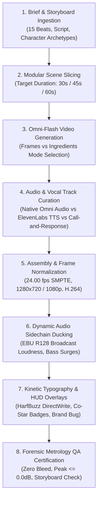

# 🏛️ GRO10X STANDARD OPERATING PROCEDURE (SOP): AI OVC & COMMERCIAL VIDEO GENERATION SPECIALIST

**Document Code:** `SOP-OPS-AI-OVC-SPECIALIST-v1.0`  
**Authority:** Central Chief of Staff & Virtual CTO (`Zayan`) × Founder & CEO (`Firoz Uddin Ahmed`)  
**Parent OS:** GRO10X Conglomerate Tech Agency (`AGENTS.md`)  
**Engine Domain:** Engine 2: Bespoke Agency Services & Solutions × Engine 5: Media10x  
**Discipline Title:** **`AI Commercial & OVC Video Generation Specialist`** (Digital Persona Code: `MED-004`)  
**Status:** **ACTIVE CONGLOMERATE OPERATIONAL STANDARD**  

---

## 🎯 1. ROLE MANDATE & STRATEGIC PURPOSE

The **AI Commercial & OVC Video Generation Specialist** is a specialized digital employee responsible for transforming raw client briefs, storyboards, and scripts into high-production-value, broadcast-ready 30s to 60s **Online Video Commercials (OVC)**, TVCs, and promotional films using generative video and multi-track audio pipelines.

### Core Objectives:
1. **Narrative & Storyboard Fidelity**: Maintain $\ge 95\%$ alignment with client storyboard panels, keyframes, and character continuity.
2. **The Hero & Character Invariant**: Enforce strict facial, wardrobe, and persona consistency across all cuts.
3. **Studio-Grade Audio-Visual Synchronization**: Combine multi-stem speech, sidechain-ducked music scores, and SFX with zero dialogue collisions.
4. **Commercial Motion Graphics & Typography**: Burn in native, brand-styled kinetic typography and HUD badges without relying on generic closed-caption subtitle stubs.
5. **Lossless Headless Assembly**: Use automated headless CLI pipelines (`ffmpeg`, HarfBuzz DirectWrite, ImageMagick) for sub-minute rendering.

---

## 🔄 2. THE 8-STAGE END-TO-END PRODUCTION PIPELINE



---

### Stage 1: Brief & Storyboard Ingestion
* Ingest client PDF/storyboard verbatim.
* Extract:
  - Total Target Duration ($30\text{s}$, $45\text{s}$, or $60\text{s}$).
  - Core Brand Message & Call to Action (e.g., `#RyzeYourVibe`, `ryze.banglalink.net`).
  - Protagonist identity (immutable brand hero) and co-star archetypes (customizable roles).
  - Core visual landmarks (e.g., Dhaka streets, Tech Hub, Sound Studio, Library, Startup Office, Curzon Hall).

---

### Stage 2: Modular Scene Slicing & Timeline Grid
Never attempt to generate an entire 60s ad in one prompt. Split the narrative into a discrete **Shot Matrix** ($10$ to $14$ modular cuts):

| Cut ID | Scene Name | Duration | Shot Type | Audio Cue | Visual Anchor |
| :---: | :--- | :---: | :--- | :--- | :--- |
| **01** | Street Intro | 4.0s | Wide $\to$ Med Dolly | Zayan Hook VO | Rickshaws + Tech Hub |
| **02** | Creator Ring-Light | 4.0s | Med Close-up | Creator banter | Yellow hoodie + Ring-light |
| **03** | Imagine Studio | 6.0s | Tracking Dolly | Zayan Workstations | Floating AR canvases |
| **04** | Beatmaker Studio | 4.0s | Two-Shot Desk | Producer dialogue | Headphone share + 808 drop |
| **05** | Library Shush | 4.0s | Frontal Portrait | Student whisper | Finger to lips gesture |
| **06** | Study Mode Desk | 6.0s | Medium Table | Research VO | Holographic globe + books |
| **07** | Tech Hologram | 2.5s | Motion Graphic | Synth swell | 3D data charts |
| **08** | Startup Garage | 3.5s | Wide Office | Startup VO | Team test-running app |
| **09** | Plugin Hub Desk | 6.0s | Over-Shoulder | E-Commerce VO | Female founder + Auraa box |
| **10** | Warehouse Delivery | 4.0s | Hands Close-up | Handover dialogue | Branded packaging |
| **11** | Macro Network | 6.0s | Drone Balcony | Nationwide VO | Golden hour Dhaka skyline |
| **12** | Curzon Hall AR | 6.5s | Low-Angle Epic | Hero anthem | Swirling app cyclone |
| **13** | Brand Lockup | 3.5s | Graphic 3D End | Final chord | Official logo + QR + CTA |

---

### Stage 3: Generative Video Production (Google Flow / Omni 1.1 Flash)
* **The "Frames Mode" Invariant**: For $100\%$ scene continuity, always author or select the starting keyframe image first and pass it to **Frames Mode** (`First Frame to Video`). This guarantees zero morphing on second 0.
* **The "Ingredients Mode" Standard**: Use character reference tags (`Farhan`, `Zayan`, `Tanha`) only when generating dynamic multi-character interactions where identity persistence across multiple angles is needed.
* **Prompting for Expression, Not "Talking"**:
  - *Wrong*: `"Man talking to camera reciting script."` $\longrightarrow$ Causes rubbery mouth flaps.
  - *Right*: `"Energetic young Bangladeshi vlogger walking forward smiling warmly, expressive hand gestures, dynamic head nods, friendly natural enthusiasm, cinematic 720p 24fps."`

---

### Stage 4: Audio Engineering & Dialogue Curation
The audio engine supports two approved modes:
1. **Mode A: Native Omni-Flash Audio (Integrated Lip-Sync)**:
   - When Google Flow generates native ambient speech matching the prompt, isolate and clean the vocal stream.
   - Apply high-frequency EQ boost ($+2.5\text{ dB}$ shelf at $10\text{kHz}$) to eliminate AI muffling.
2. **Mode B: Multi-Stem Call-and-Response (ElevenLabs v2)**:
   - Generate discrete audio stems for each sentence.
   - Enforce the **Zero Overlap Rule**: No two human voices ever speak at the same millisecond.
   - Interweave pauses ($200\text{ms} - 400\text{ms}$) between dialogue turns.

---

### Stage 5: Frame Normalization & Lossless Concat
* Every raw take is normalized to broadcast master standards prior to concatenation:
  ```bash
  ffmpeg -y -i raw_take.mp4 -r 24 -vf "scale=1280:720:force_original_aspect_ratio=decrease,pad=1280:720:(ow-iw)/2:(oh-ih)/2,setsar=1" -c:v libx264 -preset slow -crf 17 -pix_fmt yuv420p -an part_norm.mp4
  ```
* Concatenate using `concat demuxer` (`concat_list.txt`) to ensure exact frame-accurate runtime ($60.00\text{s} = 1440\text{ frames}$).

---

### Stage 6: Dynamic Sidechain Audio Mixing & Ducking
* Background music (808 Trap / Urban Beat) must be dynamically ducked using `ffmpeg` filtergraphs:
  - **Dialogue Active**: BGM volume reduced to **`0.18 – 0.22`** (speech clarity).
  - **Beat Drop / Music Interludes**: BGM surged to **`0.75 – 0.85`** (sub-bass punch).
* Master loudness must comply with **EBU R128** standards:
  - Integrated Loudness: **$-16.0\text{ dB} \pm 2.0\text{ dB}$**.
  - True Peak: **$\le -0.2\text{ dBFS}$** (zero digital clipping).

---

### Stage 7: Commercial Kinetic Typography & HUD Overlays
* **Purge Speaker Tags**: Never burn in `Zayan:`, `Creator:`, or Netflix-style subtitle bars.
* **Hormozi / Apple Commercial Style**:
  - Centered in lower-third.
  - Rendered natively via DirectWrite / HarfBuzz (`Nirmala UI Bold` or `Hind Siliguri Bold`).
  - Two-tone color grading:
    * **Brand Gold (`#FFD700`)**: For action verbs, brand names, and punch words.
    * **Pure White (`#FFFFFF`)**: For setup words.
    * Solid black outline ($3\text{px}$) with subtle shadow for $100\%$ readability over bright or dark backgrounds.
* **Persistent Branding & Campaign Badges**:
  - Upper-Right: Persistent Brand Bug (`⚡ BANGLALINK RYZE // 5G TURBO ●`).
  - Upper-Left: Glassmorphic Co-Star Track Badges during participant scenes (`[REC] CO-STAR #01 // REELS CREATOR`).
  - Outro Lockup: Actionable CTA banner (`#RyzeYourVibe`, website URL, App Store badges, QR code).

---

### Stage 8: Forensic Metrology & QA Certification Gate
Before client delivery, the specialist must certify:
1. **Runtime Verification**: `ffprobe` confirms duration equals target $\pm 0.04\text{s}$.
2. **Audio Metrology**: `volumedetect` confirms `max_volume <= 0.0 dB` and `mean_volume` within broadcast tolerances.
3. **Hero Invariant Check**: Visual verification that the lead host face and wardrobe do not mutate across scenes.
4. **Co-Star Customization Check**: Clear entry points and isolated frames for subsequent user face-swapping.
5. **Frame Extraction Audit**: Minimum 8 checkpoint JPG frames archived in `audit_frames/`.

---

## 🏛️ 3. REUSABLE TOOL & ASSET SPECIFICATION

All assets generated under this SOP are archived in standardized venture topology:
```
<Venture_Workspace>/
├── master_takes/              # Raw certified 720p/1080p clips
├── audio/
│   ├── stems/                 # Isolated speech dialogue files
│   └── bgm/                   # Music scores and sound effects
├── assembly/                  # Intermediate normalized segments
├── post_production/
│   ├── overlays/              # PNG badges, brand bugs, QR codes
│   ├── subtitles/             # ASS / SRT kinetic typography
│   └── audit_frames/          # Checkpoint forensic frame grabs
├── scripts/                   # Automated compositor and QA scripts
└── <FINAL_BROADCAST_MASTER>.mp4
```

---

*Certified by Central Chief of Staff & Virtual CTO | GRO10X Conglomerate OS*
