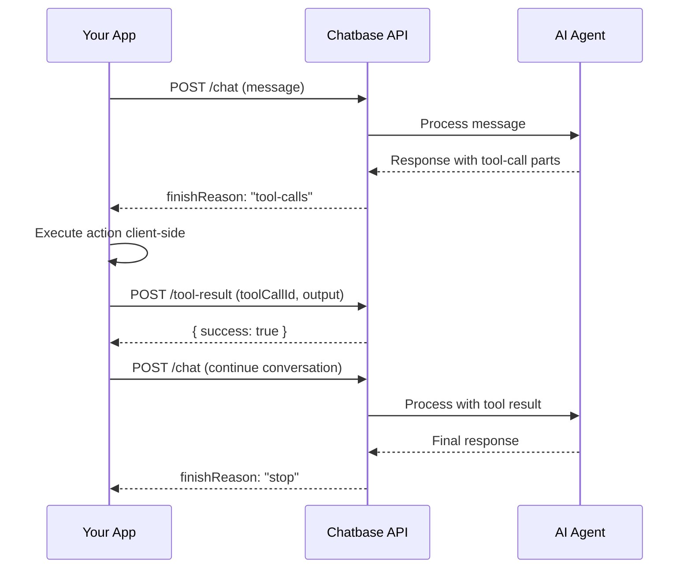

> ## Documentation Index
> Fetch the complete documentation index at: https://chatbase.co/docs/llms.txt
> Use this file to discover all available pages before exploring further.

# Client Actions

> Handle client-side actions invoked by your AI agent through the Chatbase API v2.

## What Are Client Actions?

Client actions allow your AI agent to request that your application perform an action on the client side. When an AI agent determines it needs external information or wants to trigger an operation, it responds with a `finishReason` of `"tool-calls"` and includes `tool-call` parts describing what it needs.

Your application executes the action, submits the result back to the API, and then continues the conversation.

<Note>
  Client actions correspond to the **Custom Actions** configured on your AI agent in the Chatbase dashboard. The `toolName` in the API response is the name of the configured action.
</Note>

## Flow



<Steps>
  <Step title="Send a chat message">
    Send a message to the chat endpoint as usual.
  </Step>

  <Step title="Receive a client action request">
    The response has `finishReason: "tool-calls"` and `tool-call` parts containing `toolCallId`, `toolName`, and `input`.
  </Step>

  <Step title="Execute the action client-side">
    Use `toolName` and `input` to determine what to do and execute the action in your application.
  </Step>

  <Step title="Submit the result">
    Send the result to `POST /agents/{agentId}/conversations/{conversationId}/tool-result` with the `toolCallId` and `output`.
  </Step>

  <Step title="Continue the conversation">
    Call the chat endpoint again with the `conversationId`. You can omit `message` to let the AI agent continue based on the tool result alone, or include a new message.
  </Step>
</Steps>

## Message Parts

Responses can include three types of parts in the `parts` array:

<CardGroup cols={1}>
  <Card title="text" icon="font">
    Text content generated by the AI agent.

    Fields: `type`, `text`
  </Card>

  <Card title="tool-call" icon="bolt">
    A client action the AI agent wants your app to execute.

    Fields: `type`, `toolCallId`, `toolName`, `input`
  </Card>

  <Card title="tool-result" icon="check">
    The result of a previously executed client action (visible in conversation history).

    Fields: `type`, `toolCallId`, `toolName`, `output`
  </Card>
</CardGroup>

## Detecting a Client Action

Check the `finishReason` in the response metadata. When it is `"tool-calls"`, the `parts` array will contain one or more `tool-call` entries:

```json theme={null}
{
  "data": {
    "id": "msg_abc123",
    "role": "assistant",
    "parts": [
      { "type": "text", "text": "Let me look up that order for you." },
      {
        "type": "tool-call",
        "toolCallId": "call_abc123",
        "toolName": "lookupOrder",
        "input": { "orderId": "ORD-123" }
      }
    ],
    "metadata": {
      "userMessageId": "msg_xyz789",
      "conversationId": "a1b2c3d4-e5f6-4a7b-8c9d-0e1f2a3b4c5d",
      "userId": "user_abc123",
      "finishReason": "tool-calls",
      "usage": { "credits": 2 }
    }
  }
}
```

## Submitting the Result

After executing the action, submit the result using the tool-result endpoint:

```
POST /api/v2/agents/{agentId}/conversations/{conversationId}/tool-result
```

### Request Body

<ParamField body="toolCallId" type="string" required>
  The `toolCallId` from the `tool-call` part in the chat response.
</ParamField>

<ParamField body="output" type="any">
  The result of executing the action.
</ParamField>

### Response

```json theme={null}
{
  "data": {
    "success": true
  }
}
```

## Continuing the Conversation

After submitting the tool result, continue the conversation by calling the chat endpoint again. You can either:

* **Omit `message`** to let the AI agent continue based on the tool result alone.
* **Include a `message`** to provide additional context or a follow-up question.

You must include the `conversationId` to continue the same conversation.

```bash theme={null}
curl -X POST 'https://www.chatbase.co/api/v2/agents/YOUR_AGENT_ID/chat' \
  -H 'Authorization: Bearer YOUR_API_KEY' \
  -H 'Content-Type: application/json' \
  -d '{
    "conversationId": "a1b2c3d4-e5f6-4a7b-8c9d-0e1f2a3b4c5d"
  }'
```

## Streaming Client Actions

When streaming is enabled, client action input arrives incrementally through these events:

<Steps>
  <Step title="tool-input-start">
    Signals the start of a client action. Includes `toolCallId` and `toolName`.
  </Step>

  <Step title="tool-input-delta">
    Incremental chunks of the action input stream in.
  </Step>

  <Step title="tool-input-available">
    The complete input is ready. You can read the full `input` object directly from this event without concatenating the preceding deltas.
  </Step>
</Steps>

The stream's `finish` event will have `finishReason: "tool-calls"`. See [Streaming](/docs/api-v2/streaming) for full event type reference.

## Code Examples

<CodeGroup>
  ```javascript Node.js theme={null}
  // Step 1: Send a message
  const chatResponse = await fetch(
    "https://www.chatbase.co/api/v2/agents/YOUR_AGENT_ID/chat",
    {
      method: "POST",
      headers: {
        Authorization: "Bearer YOUR_API_KEY",
        "Content-Type": "application/json",
      },
      body: JSON.stringify({
        message: "What's the status of order ORD-123?",
        stream: false,
      }),
    }
  );

  const { data } = await chatResponse.json();
  const { conversationId, finishReason } = data.metadata;

  // Step 2: Check if a client action was invoked
  if (finishReason === "tool-calls") {
    for (const part of data.parts) {
      if (part.type === "tool-call") {
        // Step 3: Execute the action
        const result = await executeAction(part.toolName, part.input);

        // Step 4: Submit the result
        await fetch(
          `https://www.chatbase.co/api/v2/agents/YOUR_AGENT_ID/conversations/${conversationId}/tool-result`,
          {
            method: "POST",
            headers: {
              Authorization: "Bearer YOUR_API_KEY",
              "Content-Type": "application/json",
            },
            body: JSON.stringify({
              toolCallId: part.toolCallId,
              output: result,
            }),
          }
        );
      }
    }

    // Step 5: Continue the conversation
    const continueResponse = await fetch(
      "https://www.chatbase.co/api/v2/agents/YOUR_AGENT_ID/chat",
      {
        method: "POST",
        headers: {
          Authorization: "Bearer YOUR_API_KEY",
          "Content-Type": "application/json",
        },
        body: JSON.stringify({
          conversationId,
          stream: false,
        }),
      }
    );

    const continued = await continueResponse.json();
    console.log(continued.data.parts);
  }

  // Your action handler
  async function executeAction(toolName, input) {
    switch (toolName) {
      case "lookupOrder":
        // Call your order service
        return { status: "shipped", eta: "2026-04-03" };
      default:
        return { error: "Unknown action" };
    }
  }
  ```

  ```python Python theme={null}
  import requests

  API_KEY = "YOUR_API_KEY"
  AGENT_ID = "YOUR_AGENT_ID"
  BASE_URL = "https://www.chatbase.co/api/v2"
  HEADERS = {
      "Authorization": f"Bearer {API_KEY}",
      "Content-Type": "application/json",
  }

  # Step 1: Send a message
  chat_response = requests.post(
      f"{BASE_URL}/agents/{AGENT_ID}/chat",
      headers=HEADERS,
      json={
          "message": "What's the status of order ORD-123?",
          "stream": False,
      },
  ).json()

  data = chat_response["data"]
  conversation_id = data["metadata"]["conversationId"]
  finish_reason = data["metadata"]["finishReason"]

  # Step 2: Check if a client action was invoked
  if finish_reason == "tool-calls":
      for part in data["parts"]:
          if part["type"] == "tool-call":
              # Step 3: Execute the action
              result = execute_action(part["toolName"], part["input"])

              # Step 4: Submit the result
              requests.post(
                  f"{BASE_URL}/agents/{AGENT_ID}/conversations/{conversation_id}/tool-result",
                  headers=HEADERS,
                  json={
                      "toolCallId": part["toolCallId"],
                      "output": result,
                  },
              )

      # Step 5: Continue the conversation
      continued = requests.post(
          f"{BASE_URL}/agents/{AGENT_ID}/chat",
          headers=HEADERS,
          json={
              "conversationId": conversation_id,
              "stream": False,
          },
      ).json()

      for part in continued["data"]["parts"]:
          if part["type"] == "text":
              print(part["text"])


  def execute_action(tool_name, tool_input):
      if tool_name == "lookupOrder":
          return {"status": "shipped", "eta": "2026-04-03"}
      return {"error": "Unknown action"}
  ```

  ```bash curl theme={null}
  # Step 1: Send a message
  curl -X POST 'https://www.chatbase.co/api/v2/agents/YOUR_AGENT_ID/chat' \
    -H 'Authorization: Bearer YOUR_API_KEY' \
    -H 'Content-Type: application/json' \
    -d '{
      "message": "What is the status of order ORD-123?",
      "stream": false
    }'

  # Step 2: Submit the tool result (use toolCallId from the response)
  curl -X POST 'https://www.chatbase.co/api/v2/agents/YOUR_AGENT_ID/conversations/CONVERSATION_ID/tool-result' \
    -H 'Authorization: Bearer YOUR_API_KEY' \
    -H 'Content-Type: application/json' \
    -d '{
      "toolCallId": "call_abc123",
      "output": { "status": "shipped", "eta": "2026-04-03" }
    }'

  # Step 3: Continue the conversation
  curl -X POST 'https://www.chatbase.co/api/v2/agents/YOUR_AGENT_ID/chat' \
    -H 'Authorization: Bearer YOUR_API_KEY' \
    -H 'Content-Type: application/json' \
    -d '{
      "conversationId": "CONVERSATION_ID"
    }'
  ```
</CodeGroup>

## Error Handling

| Code | Status | Description |
| - | - | - |
| `RESOURCE_TOOL_CALL_NOT_FOUND` | 404 | No pending client action matches the provided `toolCallId`. It may have expired or already been resolved. |
| `VALIDATION_INVALID_BODY` | 400 | The request body failed schema validation. Check the `details` field for specifics. |


This documentation is built and hosted on [Mintlify](https://mintlify.com), a developer documentation platform.