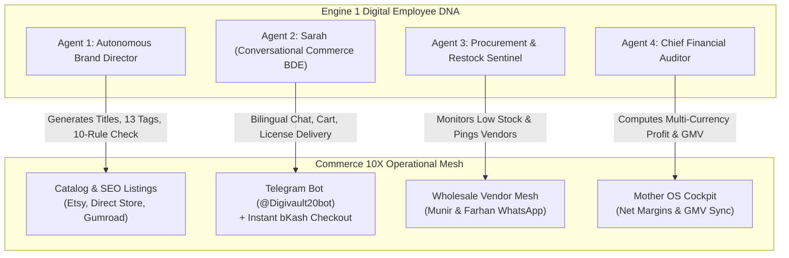

# 🤖 Commerce 10X — AI Synergy Blueprint (Powered by Engine 1: Agent 10X)

> **Ecosystem**: GRO10X Holdings · Cross-Engine Autonomous Synergy  
> **Participating Engines**: **Engine 1** (`D:\agent10x.ai`) $\times$ **Engine 3** (`D:\commerce10x.ai`)  
> **Status**: Core Strategic Architecture Blueprint

---

## 1. Executive Vision: The Autonomous E-Commerce Conglomerate

Traditional digital product businesses (on Etsy, Gumroad, or Shopify) suffer from extreme human operational fatigue:
* Creating 100 new product mockups and writing descriptions takes weeks of manual labor.
* Responding to customer inquiries on Telegram or WhatsApp at 2 AM delays sales.
* Manually checking subscription inventories (e.g. Canva Edu, ChatGPT Plus) and messaging wholesale suppliers creates stockouts.
* Manually calculating profit margins across USD and BDT multi-currency channels causes accounting errors.

**By infusing Engine 1's Digital Employee intelligence into Commerce 10X, we replace these manual bottlenecks with autonomous digital workers.**

---

## 2. The 4 Autonomous Digital Workers of Commerce 10X

---

### Worker 1: The Autonomous Brand Director
* **Identity**: Derived from Engine 1's `@profiler` and `@hiring_manager` prompt architectures.
* **Assigned To**: Each of the 13 Digital Brands has an instance (e.g. *PlannerQueen Brand Director*, *WildMutt Brand Director*).
* **Autonomous Tasks**:
  1. **Automated Listing Drafting**: Consumes raw design PDFs from cloud storage and generates 70–140 character SEO titles, 13 targeted tags, and 300-word descriptions.
  2. **Rule Enforcement**: Runs the **10-Rule AI Health Check** before submitting drafts to the Etsy API or Direct Store.
  3. **Seasonal Variant Generation**: Suggests seasonal bundles (e.g., "Q4 Holiday Budget Planner Bundle") based on sales trends.

---

### Worker 2: Sarah — Conversational Commerce BDE
* **Identity**: The high-converting sales persona established in Engine 1 (`sarah-bde-fintech`), now adapted for consumer digital commerce.
* **Assigned To**: Powering `@Digivault20bot` and web live chat.
* **Autonomous Tasks**:
  1. **Bilingual Advisory (EN / BN)**: Converses naturally with buyers in English or Bangla, explaining software features, subscription durations, and device limits.
  2. **1-Tap Upselling**: Recommends complementary bundles (e.g. "Get ChatGPT Plus + Canva Edu together and save 25%").
  3. **Automated Payment Guidance**: Guides bKash/Nagad transactions, parses payment screenshots via multimodal vision, and instantly releases the 32-character license key upon confirmation.

---

### Worker 3: The Procurement & Restock Sentinel
* **Identity**: Derived from Engine 1's autonomous cron and notification mesh.
* **Assigned To**: Vertical 2 (DigiVault Subscriptions & Wholesale Licenses).
* **Autonomous Tasks**:
  1. **Safety Stock Polling**: Evaluates `stock_quantity` across all 44 subscription products every 30 minutes.
  2. **1-Tap WhatsApp Wholesale PO**: When stock drops below 3 units, dispatches an automated purchase order with pre-formatted WhatsApp links to wholesale vendors (Munir & Farhan).
  3. **Auto-Restock Ingestion**: Ingests new activation credentials delivered by vendors and moves them directly into the encrypted vault.

---

### Worker 4: The Multi-Currency Financial Auditor
* **Identity**: The financial intelligence agent interfacing with Engine 1's credit ledger.
* **Assigned To**: Cross-Channel Financial Reconciliation.
* **Autonomous Tasks**:
  1. **Unified GMV Computation**: Aggregates revenue across Etsy (USD), Gumroad (USD), Direct bKash (BDT), and Daraz (BDT) using the canonical 120 BDT/USD exchange rate.
  2. **Automatic Mother OS Reporting**: Feeds live daily GMV and net profit telemetry into `src/services/commerce10x-bridge.js` to populate Engine 3 metrics in the Mother OS Cockpit.

---

## 3. Technical Integration Points: How Engine 1 Code is Reused

1. **Credit Ledger & Wallet**:
   * The atomic credit deduction engine from `D:\agent10x.ai\server\src\routes\wallet.js` is reused for customer loyalty points and subscription credit balances in Commerce 10X.
2. **AES-256 Vault Architecture**:
   * The credential encryption vault from `D:\agent10x.ai\server\src\routes\auth.js` encrypts customer passwords, Etsy OAuth refresh tokens, and digital license credentials in Commerce 10X.
3. **SSE Streaming Gateway**:
   * The SSE streaming server pattern from `D:\agent10x.ai\server\src\routes\chat.js` powers the live real-time order notifications on the Commerce 10X merchant dashboard.
