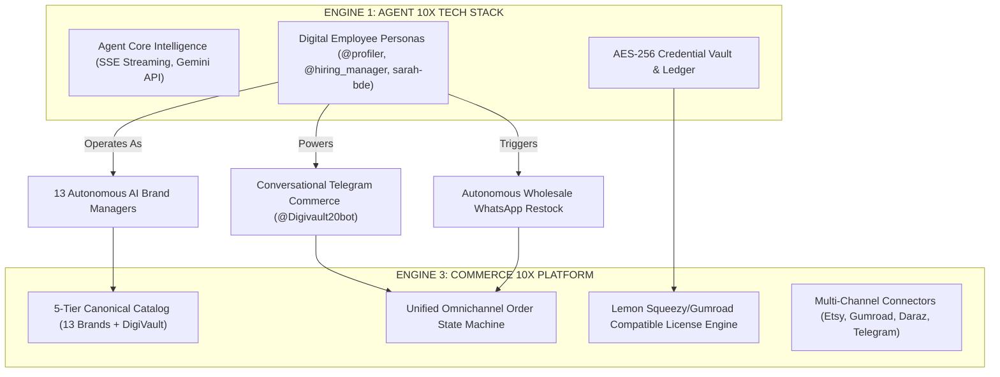

# 🌐 Commerce 10X — Global Benchmarking & Competitive Intelligence Matrix

> **Ecosystem**: GRO10X Holdings · Engine 3 Standalone Venture (`D:\commerce10x.ai`)  
> **Purpose**: Global competitive analysis and architecture benchmarking for digital asset commerce, omnichannel fulfillment, and autonomous brand management.  
> **Status**: Canonical Reference Document

---

## 1. Global Platform Competitive Landscape

| Capability / Dimension | **Gumroad** | **Lemon Squeezy** | **Whop** | **Etsy Open API v3** | **Commerce 10X (Our Venture)** |
| :--- | :--- | :--- | :--- | :--- | :--- |
| **Core Value Prop** | Pioneer creator checkout & digital file delivery | Merchant of record, developer-first licensing | Social & Telegram/Discord community commerce | Global handmade & vintage marketplace | **Autonomous AI-staffed omnichannel commerce & digital asset empire** |
| **Digital License API** | `/v2/licenses/verify` (Product ID + Key) | `/v1/licenses/activate`, `validate`, `deactivate` | Access passes & membership tier checks | N/A (Instant download PDF/ZIP) | **Hybrid Lemon Squeezy + Gumroad Cryptographic Key Engine** |
| **Payment Rails** | Stripe, PayPal, Global Cards | Stripe, Global Merchant of Record (MoR) | Stripe, Apple Pay, Crypto, Cards | Etsy Payments (Direct deposit) | **Dual-Rail: bKash / Nagad Instant Auto-Verify (BD) + Stripe / Cards (Global)** |
| **Messaging / Bot Commerce** | None | None | Telegram & Discord Bot gating | None | **Bilingual Telegram Customer Bot (`@Digivault20bot`) + WebApp PWA** |
| **Catalog Architecture** | Flat products with variant matrices | Products → Variants → Files/Licenses | Companies → Products → Plans → Experiences | Shops → Sections → Listings → Variations | **5-Tier Hierarchy: Verticals → Brands → Categories → Products → SKUs** |
| **Autonomous Operations** | Manual creator management | Manual creator management | Manual community admin | Manual shop manager | **Engine 1 Digital Employees (Autonomous Brand Managers, AI BDE, Restock Sentinels)** |

---

## 2. Deep-Dive Benchmark Analysis

### Pillar A: Gumroad (Frictionless Checkout & Simple Licensing)
* **What Gumroad Does Best**:
  * Clean, embeddable modal overlay checkout (`gumroad-overlay`).
  * Simple, robust License Verification API: `POST /v2/licenses/verify` with `product_id` and `license_key`.
  * Instant webhook delivery (`sale` and `refund` events) with detailed customer and purchase JSON payloads.
* **Where Gumroad Falls Short**:
  * Heavy 10% + processing fee structure.
  * No localized emerging market payment rails (bKash, Nagad, UPI).
  * No automated fulfillment for wholesale procured subscription accounts.

### Pillar B: Lemon Squeezy (Enterprise License Lifecycle)
* **What Lemon Squeezy Does Best**:
  * Complete 3-state license lifecycle:
    1. `activate`: Binds key to device/instance (`instance_name`).
    2. `validate`: Fast runtime check (supports caching).
    3. `deactivate`: Unbinds instance, freeing license seat for re-use.
  * Webhook payload security using HMAC SHA-256 signatures (`x-signature` header).
* **Adoption for Commerce 10X**:
  * Commerce 10X will implement this exact 3-state license activation pattern in `dce_digital_licenses`.

### Pillar C: Whop (Social, Telegram & Community Gating)
* **What Whop Does Best**:
  * Unmatched monetization of Telegram channels and bot communities.
  * Seamless linking between customer web identity and Telegram user ID (`telegram_id`).
  * Automated bot kicking/admitting upon subscription renewal or cancellation.
* **Adoption for Commerce 10X**:
  * Commerce 10X uses `@Digivault20bot` and Telegram Mini Apps (TMA) to deliver the exact same social-first checkout experience directly within Telegram.

### Pillar D: Etsy Open API v3 (Marketplace Scale & Search Dominance)
* **What Etsy Does Best**:
  * Massive global organic search traffic for printable planners, digital templates, and SVGs.
  * Structured taxonomy tree (`taxonomy_id`) and strict 13-tag SEO algorithm.
  * Secure OAuth2 PKCE authorization for third-party tools.
* **Adoption for Commerce 10X**:
  * The **Etsy OS Engine** (`src/services/etsy.js`) connects directly to Etsy OpenAPI v3 to automatically sync 13 brand catalogs, audit SEO health, and stream Vault assets directly to Etsy buyers.

---

## 3. The Unfair Advantage: Infusing Engine 1 (Agent 10X)

No global player offers **autonomous operations**. By coupling Commerce 10X with Engine 1's Digital Employee architecture, Commerce 10X operates without human operational bottlenecks:

